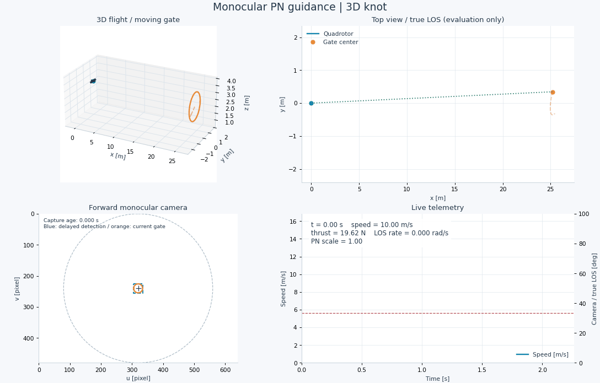
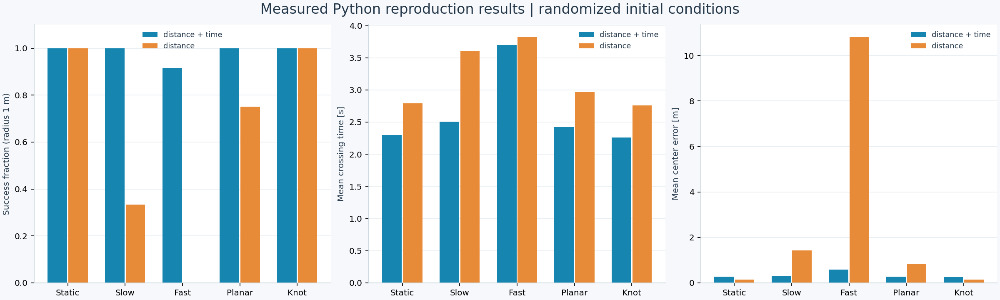

# Moving Gates Reproduction — PN

基于比例导航（Proportional Navigation，PN）的四旋翼移动门穿越：论文 **Flying through Moving Gates without Full State Estimation** 的独立 Python 仿真复现。

项目由单目相机检测框和理想 IMU 姿态计算视线（LOS）及变化率，再生成受推力和视野约束的姿态/推力指令。外环不读取真实位置、速度、目标距离或门尺寸。提供中文注释、五种门运动、噪声/延迟/侧风、贝叶斯参数优化、实验数据与可视化。

> 本项目复现论文的核心控制方法和主要数值实验，采用自行实现的四旋翼与相机模型。论文使用 PX4/Gazebo 和实机实验，未公开的动力学、传感器和滤波参数在本项目中作了明确假设。统计结果与论文不同，具体对照和限制见下文。

## 论文与可视化预览

- **题名**：Flying through Moving Gates without Full State Estimation
- **作者**：Ralf Römer、Tim Emmert、Angela P. Schoellig
- **复现依据**：arXiv:2410.15799v3，2025-03-18
- **论文链接**：[arXiv 页面](https://arxiv.org/abs/2410.15799v3) · [PDF](https://arxiv.org/pdf/2410.15799v3)





克隆后，可用浏览器直接打开 [`outputs/index.html`](outputs/index.html) 浏览全部结果。交互播放器位于 [`outputs/demo/knot/animation.html`](outputs/demo/knot/animation.html)，支持播放、暂停、逐帧、进度拖动和速度控制，无需网络或本地服务器。GitHub 可显示 PNG/GIF；HTML 播放器需在本地浏览器中打开。

## 快速运行

建议 Python 3.10 或以上。依赖仅有 NumPy、SciPy、Matplotlib 和 Pillow，无需 ROS2、PX4、Gazebo、GPU 或 FFmpeg。克隆并安装：

```bash
git clone https://github.com/BITkunkun/moving_gates_reproduction_PN.git
cd moving_gates_reproduction_PN
python -m pip install -r requirements.txt
python -B main.py
```

默认运行三维 knot 移动门，生成静态图、可播放的离线 HTML 动画、轨迹数据，并打开 Matplotlib 窗口。关闭窗口后退出程序。首次输出动画需要一段渲染时间。

完整实验与可视化：

```powershell
python -B main.py all --no-show --gif
```

完成后用浏览器打开 **`outputs/index.html`**。其中包含五种门运动、三维/俯视/相机/遥测动画、实验图与原始 CSV。HTML 动画的播放、暂停、逐帧和速度控制无需服务器或网络。`outputs/demo/knot/animation.gif` 可直接预览。

GitHub 仓库直接管理源码、测试和正式结果。本地的 `moving_gates_python.zip` 是离线交付备份，不参与 Git 管理，运行程序无需读取它。

若系统没有 `python` 命令，Windows 可尝试 `py`。如需隔离依赖：

```powershell
python -m venv .venv
.venv\Scripts\python.exe -m pip install -r requirements.txt
.venv\Scripts\python.exe main.py all --no-show --gif
```

macOS/Linux 可使用 `python3 -m venv .venv`，再用 `.venv/bin/python` 安装依赖和运行脚本。以下命令均从仓库根目录执行；使用虚拟环境时，将 `python` 替换为相应的解释器路径。

## 单独实验

```powershell
# 五种运动：stationary / linear_slow / linear_fast / planar / knot
python main.py demo --motion linear_fast --gif

# 论文的偏保守参数预设
python main.py demo --preset distance --motion planar

# 相机延迟 100 ms、像素噪声标准差 2、侧风 3 m/s
python main.py demo --motion knot --delay 0.1 --noise 2 --wind 3 --no-show --gif --output outputs/robustness

# 每套论文参数 60 次：5 种门运动，各 12 次
python main.py benchmark --runs 12 --no-show

# 4 档延迟 × 3 个门半径 × 3 种门运动 × 12 次，共 432 次
python main.py delay --runs 12 --no-show

# 25 次总评估，包含 5 个初始采样；每次评估 8 个移动门场景
python main.py optimize --preset distance_time --iterations 25 --no-show
python main.py optimize --preset distance --iterations 25 --no-show

# 修改控制参数或初始距离
python main.py demo --k-pn 2.1 --gamma 21.05 --speed-bound 15 --distance 30 --no-show

# 仅生成图和数据，跳过耗时的动画渲染
python main.py all --no-show --no-animation --runs 3 --iterations 5 --output outputs/quick

# 物理、视觉、控制及端到端验证
python -m unittest discover -s tests -v
```

`--no-show` 适用于无图形界面环境，不影响保存图、HTML 和 GIF。只有 `--gif` 才额外输出 GIF，不需要 FFmpeg。默认输出目录位于源码旁；自定义 `--output` 为相对路径时，它相对于当前工作目录。`benchmark` 固定实际门半径 1 m，`delay` 对三个实际门半径分别仿真。

完整选项说明：`python -B main.py --help`。`--delay` 单位为秒，`--gamma` 单位为度，`--noise` 单位为 pixel，速度和长度分别采用 m/s、m。完整实验和动画渲染比单次演示耗时更长。

## 文件与交付物

| 文件 | 职责 |
|---|---|
| `main.py` | 统一命令行入口 |
| `controller.py` | PN 制导与论文闭式推力/姿态解 |
| `simulation.py` | 四旋翼、移动门、相机、滤波、延迟与穿门判定 |
| `geometry.py` | 旋转矩阵、四元数与 PN 坐标系 |
| `experiments.py` | 随机实验、延迟扫描、Matérn GP/UCB 贝叶斯优化 |
| `visualization.py` | 静态诊断图、HTML 动画、GIF、实验曲线 |
| `reporting.py` | 从保存的实验数据生成结果首页及报告 |
| `tests/test_reproduction.py` | 约束、相机旋转补偿、动力学及回归验证 |

建议先读 `main.py` 了解任务入口，再读 `simulation.py` 的 `simulate()` 跟踪单次仿真流程，随后对照 `controller.py` 阅读论文闭式控制。`geometry.py` 说明坐标系和四元数约定；`experiments.py`、`visualization.py`、`reporting.py` 分别负责批量实验、绘图和报告。上述模块已补充必要的中文注释，特别标明了物理单位、真值使用边界和视觉延迟处理。

默认完整运行输出：

```text
outputs/
  index.html                         可视化结果入口
  reproduction_report.md             真实运行结果、论文对照、复现边界
  demo/{motion}/
    summary.png                      六面板诊断图
    metrics.json                     所有配置与性能指标
    trajectory.csv                   时间、位置、速度、门位置、视角、推力
    trajectory.npz                   完整可视化与控制历史
  demo/knot/animation.html            四视图交互动画
  demo/knot/animation.gif             指定 --gif 时生成
  benchmark/
    runs.csv                         120 次逐次实验指标
    comparison_with_paper.csv         与论文表 I 的数值对照
    summary.json
    benchmark.png
    settings.json
  delay/
    runs.csv                         432 次逐次指标
    delay.png                        对应论文图 5 的实验
    settings.json
  optimization/{distance_time|distance}/
    history.csv                      25 次参数与奖励
    best_parameters.json
    optimization.png
    settings.json
```

### 运行残留与应保留的结果

| 路径 | 内容与处理 |
|---|---|
| `tmp/` | 论文提取文本、临时截图、浏览器检查页面/日志及配置；临时检查产物，可清理 |
| `__pycache__/`、`tests/__pycache__/` | 自动生成的 `.pyc` 字节码缓存；可清理，普通运行时可能重新生成 |
| `outputs/` | 实验数据、动画、图表、报告和验证记录；属于正式结果，随仓库提供 |
| `moving_gates_python.zip` | 本地离线交付备份；由 `.gitignore` 排除 |

如希望本次运行不产生字节码缓存，可以使用 `python -B main.py` 或 `python -B -m unittest discover -s tests -v`。无需修改算法或安装依赖。

`.gitignore` 同时排除本地虚拟环境、检查缓存和机器配置；正式 `outputs/` 数据继续由 Git 管理。

动画在上半部分展示三维飞行和俯视轨迹，下半部分展示前向相机投影与实时遥测。橙色为门，蓝色为四旋翼或已交付的视觉检测框，绿色为法向制导加速度。相机图中橙色圆环来自当前成像，蓝色框来自延迟后的检测，所以存在延迟时二者可以错开。

## 与论文公式的对应

1. **四旋翼状态与内环，式 (3)**：状态包含位置、单位四元数、速度、机体系角速度。姿态误差生成角速度指令，角速度按一阶系统跟踪。额外使用一阶电机推力响应。平移采用二阶预测/校正积分，旋转采用指数映射与四元数归一化；动力学 240 Hz，视觉和控制 30 Hz。
2. **单目 LOS，式 (4)**：圆形门边界投影到相机，计算检测框中心，加像素噪声，再通过相机内参恢复单位方向。使用拍摄时刻的 IMU 姿态转换到世界系，滤波后求相邻方向夹角/时间间隔。通过 `atan2(||l×l_prev||, l·l_prev)` 计算，等价于论文的 `arccos`，小角度更稳定。
3. **无速度测量 PN，式 (5)**：`a_n = k_PN * speed_bound * LOS_rate * n`，其中 `k_l = unit(l × l_prev)`，`n = unit(l × k_l)`。没有估计或读取真实相对速度。
4. **PN 坐标系，式 (6)-(8)**：将论文的基向量归一化得到正交旋转矩阵，以 LOS 为 x 轴、世界竖直方向确定另外两轴，并把重力转换到 PN 系。
5. **闭式控制，式 (9)-(15)**：求法向加速度对应的滚转与俯仰，在推力上限和论文视野约束下最大化沿 LOS 的推力分量。无需在线数值姿态优化。
6. **贝叶斯优化，式 (16)**：搜索 `k_PN ∈ [0.3,3]`、`gamma ∈ [5°,30°]`，使用 Matérn-5/2 高斯过程和 UCB。两个奖励分别为 `max(0, 10/t - 3*d)`、`max(0, -5*d + 3)`。超时等未越过门平面的失败奖励为 0。

### 两处公式约定与可行性

**质量单位**：式 (8) 包含质量 `m`，但式 (11)-(15) 的推导省略了它。代码中用单位质量推力 `s=f/m`（m/s²）计算闭式解，再输出真实推力 `f=m*s`（N），以保持式 (3) 的物理量一致。

**相机夹角**：按照论文式 (10) 的标准旋转，`R_y(phi) R_x(theta) e_x = [cos(phi),0,-sin(phi)]`，所以前向相机真实夹角满足 `cos(gamma)=cos(phi)`。论文文字却给出 `cos(phi)cos(theta)`。代码保留论文式 (15) 的推力上限 `s <= Z/cos(gamma_max)`（`Z=a_n,z-g_z`），它构成一个更保守的约束，并保证指令相机夹角满足上限。图与轨迹同时保存实际几何夹角及论文约束的代理夹角。这里的闭式最优性针对论文采用的保守约束。

**不可行请求**：论文未指定 PN 法向加速度超出约束集合后的策略。代码用二分法缩小法向加速度的幅值，保留其方向，使推力、姿态和视野约束可行，并记录 `saturation_scale`。这是仿真实现选择。垂直 LOS 无法定义论文 PN 坐标系，按失败记录。

## 传感器与真值隔离

控制器的输入类型 `Guidance` 只有 **LOS 单位向量、LOS 角速度、法向单位向量、拍摄时间**，不含位置、速度、距离、门尺寸、门轨迹或运动类别。控制器另外知道质量、推力上限、固定速度上界和重力常数。

位置真值用于合成相机图像；速度真值用于更新动力学；完整状态用于图表和穿门评分。内环姿态对应理想 IMU 姿态测量，**本项目没有模拟 IMU 姿态漂移或视觉检测网络**。视觉检测是基于投影几何的检测框模拟，不含 YOLO/Nanotrack 权重。视觉延迟通过带时间戳的队列实现，不会用当前真值修正陈旧测量。检测消失时保持最近有效指令。

## 实验参数与复现假设

| 参数 | 默认值 | 来源 |
|---|---:|---|
| 质量 | 2 kg | 论文 |
| 视觉/制导频率 | 30 Hz | 论文 |
| 相机 LOS 锥半角阈值 | 33.5° | 按论文 γ_cam 约束解释 |
| 固定相对速度上界 | 15 m/s | 论文仿真实验 |
| 初始速度 | 10 m/s | 论文 |
| 门运动中心初始 x 距离 | 20-30 m | 按论文区间随机；轨道偏移会改变精确初始距离 |
| 初始速度与 LOS 夹角 | -10° 至 +10° | 论文；扰动方位在法平面随机 |
| 直线门速度 | 2.5 / 5 m/s | 论文 slow / fast；沿世界 y 方向 |
| 平面门尺度 | 2 m | 论文 |
| knot 门尺度 | 1 m | 论文 |
| 偏时间参数 | k=2.10，γ=21.05° | 论文 BO 结果 |
| 偏距离参数 | k=1.11，γ=8.91° | 论文 BO 结果 |
| 最大推力 | 39.24 N（推重比 2） | 假设 |
| 姿态/角速度/电机时间常数 | 0.16 / 0.04 / 0.03 s | 假设 |
| 线性/二次阻力系数 | 0.08 s⁻¹ / 0.012 m⁻¹ | 假设；作用于相对风速 |
| 检测框坐标噪声标准差 | 0.4 pixel | 假设 |
| LOS 滤波时间常数 | 0.06 s | 假设 |
| 平面/knot 轨迹角频率 | 0.7 / 0.2 rad/s | 论文未明确披露；近似其运动速度与加速度 |
| 相机分辨率 | 640×480 | 假设；圆锥 FOV 内接于图像 |

运动方程严格使用论文 V-A 的形式：

```text
planar: p0 + 2 * [cos(a), 0.5*cos(2a), 0]
knot:   p0 + [sin(3a)*(1+0.5*cos(2a)), cos(3a)*sin(2a), sin(4a)]
a = omega*t + randomized_phase
```

门平面初始朝向四旋翼，此后只平移。仿真在真正跨越该**移动门平面**时，通过求根插值得到穿门时刻与平面内中心误差。成功判据是 `d_center <= gate_radius`，对应论文的点质心口径；未另加机体包络或门框碰撞模型。`benchmark` 的 2 m 列仅把同一批轨迹按 2 m 阈值重新评分；`delay` 则对每种真实半径独立合成成像并仿真。

闭式解保证的是**指令姿态相对所测 LOS** 的视角约束。真实相机角度受到内环跟踪、噪声、延迟和穿门瞬间几何的影响，可能越过视野边界。因此同时输出真实角度、检测比例、约束指令角度、饱和比例，不能把“指令满足约束”当作“真实相机始终可见”。

## 验证与范围

```bash
python -B -m unittest discover -s tests -v
```

测试覆盖：正交 PN 坐标系、四元数转换、像素方向恢复、相机自转补偿、真实时间延迟、闭式解与网格搜索最优值比较、随机控制约束、不可行请求处理、悬停平衡、五种运动的真实门平面穿越、随机种子可重复性、积分步长收敛及 GP/UCB 数值稳定性。

完整运行包括 5 个演示、120 次论文参数实验、432 次延迟实验、两套奖励各 25×8 次 BO 场景，总计 **957 次仿真**。BO 用固定 8 个训练场景，报告的训练最优参数不代表测试集泛化结果；`benchmark` 仍评估论文原参数，便于区分来源。

已覆盖论文算法 IV-A 至 IV-E、V-A 的主要模拟实验、表 I 对照和图 5 延迟研究。未复现真实飞行、ROS2/PX4/Gazebo 工程、检测网络训练、表 II 的理想速度 oracle 实验及表 III 的外部方法基线。逐门控制方法已实现，默认实验遵循论文的单门评估，没有额外提供赛道地图或多门检测选择器。

## 随仓库保存的实际实验结果

基准实验每种运动 12 次，每套参数共 60 次，成像门半径和成功阈值均为 1 m。保存的配置使用主种子 7、基准场景种子从 107 起；具体见 [`settings.json`](outputs/benchmark/settings.json)。

| 门运动 | `distance_time` 成功次数 | `distance` 成功次数 |
|---|---:|---:|
| 静止 | 12/12 | 12/12 |
| 慢直线 | 12/12 | 4/12 |
| 快直线 | 11/12 | 0/12 |
| 平面 | 12/12 | 9/12 |
| knot | 12/12 | 12/12 |
| 合计 | **59/60（98.3%）** | **37/60（61.7%）** |

以上是当前独立模型下的结果，不等同于论文成功率。较保守参数在快直线门运动中出现明显失败，相关记录已保留。BO 的训练最优参数与该表的论文原参数分开保存，不能用训练奖励推断独立测试集成功率。

- [复现报告](outputs/reproduction_report.md)
- [论文表 I 逐项对照](outputs/benchmark/comparison_with_paper.csv)
- [基准逐次记录](outputs/benchmark/runs.csv) · [延迟逐次记录](outputs/delay/runs.csv)
- [运行环境与历史源码校验记录](outputs/verification/manifest.json)

所有结果见 `outputs/reproduction_report.md` 与 CSV。由于动力学与测量模型的差异，成功率、速度、穿门时间及 BO 最优参数可与论文不同，包括某些运动上的失败；没有对结果进行筛选或写入预设的成功曲线。

交付时 11 项测试全部通过，记录保存在 `outputs/verification/tests.txt`。离线动画已通过 Edge 浏览器的播放、暂停、前后逐帧、首末帧、滑块和速度控制验证；69 帧正常加载，外部资源请求为 0，见 `browser_qa.json` 与 `browser_animation.png`。另已运行 `outputs/robustness/` 中的 100 ms 延迟、2 pixel 噪声和 3 m/s 侧风组合演示，该种子成功穿门。

## 引用

使用或讨论该控制方法时，请引用原论文。引用本项目的实验数值时，请说明采用独立 Python 模型及本 README 中的参数假设。

```bibtex
@misc{roemer2025flying,
  title         = {Flying through Moving Gates without Full State Estimation},
  author        = {Ralf R{\"o}mer and Tim Emmert and Angela P. Schoellig},
  year          = {2025},
  eprint        = {2410.15799},
  archivePrefix = {arXiv},
  primaryClass  = {cs.RO},
  url           = {https://arxiv.org/abs/2410.15799v3}
}
```
